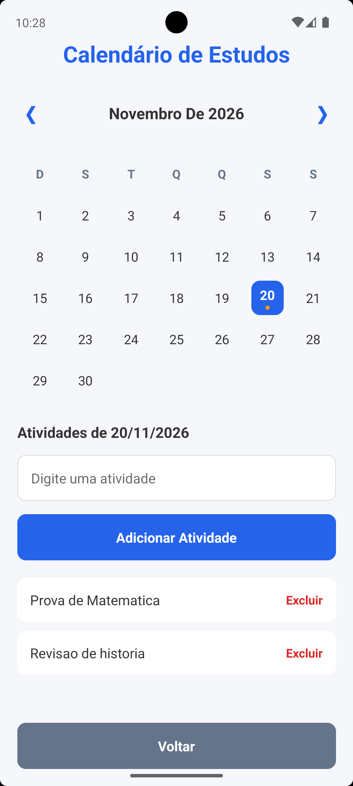

# 📚 EstudaFácil

### Organize seus estudos em um só lugar!

O **EstudaFácil** é um aplicativo de organização de estudos desenvolvido com **React Native, Expo e JavaScript**.

O projeto permite organizar tarefas, matérias escolares e atividades no calendário, mantendo as informações salvas localmente no dispositivo.

Além do desenvolvimento do aplicativo, o projeto contempla a preparação e a **simulação acadêmica de publicação na Google Play Store e na Apple App Store**.

---

## 📱 Telas do aplicativo

| Início | Tarefas | Matérias | Calendário |
|---|---|---|---|
|  |  |  |  |

As imagens foram capturadas no emulador Android Pixel 7.

---

## 🚀 Funcionalidades

### ✅ Minhas Tarefas
- Cadastrar tarefas de estudo.
- Marcar tarefas como concluídas.
- Excluir tarefas.

### 📘 Minhas Matérias
- Cadastrar matérias escolares.
- Selecionar matérias sugeridas.
- Impedir matérias duplicadas.
- Excluir matérias.

### 📅 Calendário
- Visualizar e navegar entre os meses.
- Selecionar datas.
- Cadastrar atividades em dias específicos.
- Identificar datas com atividades.
- Excluir atividades.

### 🔒 Privacidade
- Armazenamento local com AsyncStorage.
- Utilização sem cadastro ou login.
- Acesso à Política de Privacidade pela tela inicial.

---

## 🛠️ Tecnologias utilizadas

- JavaScript
- React Native
- Expo SDK 58
- AsyncStorage
- Android Studio
- EAS Build
- Git e GitHub

---

## ▶️ Como executar o projeto

### Pré-requisitos

- Node.js e npm.
- Android Studio com emulador Android ou outro ambiente compatível com Expo.
- Dependências do projeto instaladas pelo npm.

### Instalação

Clone o repositório:

```bash
git clone https://github.com/rafaelborbaalveswolney/EstudaFacil.git
```

Entre na pasta:

```bash
cd EstudaFacil
```

Instale as dependências:

```bash
npm install
```

Inicie o projeto:

```bash
npx expo start
```

Depois, utilize um ambiente compatível com o Expo para abrir o aplicativo.

---

## 📦 Compilação Android

O projeto foi compilado utilizando o **Expo EAS Build**.

**Versão:** 1.0.0  
**Código da versão Android:** 2  
**Identificador:** `com.estudafacil.app`

Foram gerados:

- **AAB de produção:** `EstudaFacil-release-v2.aab`
- **APK de testes:** `EstudaFacil-preview-v2.apk`

O AAB foi gerado com credenciais de assinatura Android gerenciadas pelo EAS Build.

O APK foi instalado e testado no emulador Pixel 7, sem depender do Expo Go.

**Observação:** os binários APK e AAB não estão armazenados diretamente no repositório Git. Os arquivos de compilação permanecem organizados localmente na pasta `01_Binarios`.

---

## 🧪 Testes realizados

Foram realizados testes das principais funcionalidades no Android:

- Instalação e abertura do APK.
- Navegação entre as telas.
- Cadastro, conclusão e exclusão de tarefas.
- Cadastro de matérias e prevenção de duplicatas.
- Navegação pelo calendário.
- Cadastro e exclusão de atividades.
- Persistência dos dados após fechar e reabrir o aplicativo.
- Abertura da Política de Privacidade.

**Resultado:** os testes funcionais realizados no emulador Pixel 7 foram aprovados.

O relatório completo está disponível em:

[Relatório de testes finais](05_Apresentacao/Relatorio_Testes_Finais.md)

---

## 🛡️ Privacidade e permissões

O EstudaFácil utiliza armazenamento local para tarefas, matérias e atividades acadêmicas, sem exigir cadastro ou login.

A Política de Privacidade pode ser consultada em:

[Política de Privacidade do EstudaFácil](https://clever-palmier-327fdc.netlify.app/)

Na análise do AAB Android versão 2, foi confirmada a remoção das permissões `SYSTEM_ALERT_WINDOW` e `VIBRATE`.

As permissões de armazenamento externo limitadas até a API 32 e a validação definitiva das práticas de dados de dependências permanecem registradas como pontos de revisão.

[Revisão de privacidade e permissões](04_Privacidade/Revisao_Privacidade_Permissoes.md)

---

## 🏪 Simulação de publicação nas lojas

A atividade acadêmica contempla a preparação dos materiais e dos procedimentos de publicação, sem envio real dos aplicativos às lojas.

### Google Play Store — Android

- Metadados e descrições preparados.
- Ícone, banner e screenshots disponíveis.
- Política de Privacidade publicada.
- Formulário de Segurança dos Dados simulado.
- AAB de produção gerado e assinado.
- Publicação real não realizada.

[Simulação da Google Play Console](05_Apresentacao/Simulacao_Google_Play.md)

### Apple App Store — iOS

- Nome, descrição, subtítulo e palavras-chave preparados.
- Ícone iOS disponível.
- Política de Privacidade publicada.
- Formulário App Privacy simulado.
- Identificador e configurações básicas iOS preparados.
- Arquivo IPA não gerado.
- Testes e publicação iOS não realizados.

[Simulação da App Store Connect](05_Apresentacao/Simulacao_App_Store_iOS.md)

---

## 📂 Organização do projeto

```text
EstudaFacil/
├── 01_Binarios/          # APK e AAB armazenados localmente
├── 02_Imagens/           # Ícones e banner promocional
├── 03_Screenshots/       # Capturas de tela do Android
├── 04_Privacidade/       # Política e documentação de privacidade
├── 05_Apresentacao/      # Simulações, testes e apresentação
├── assets/               # Recursos utilizados no aplicativo
├── src/
│   ├── screens/          # Telas do aplicativo
│   └── services/         # Armazenamento local
├── App.js
├── app.json
├── eas.json
├── package.json
└── README.md
```

---

## 🎓 Objetivo acadêmico

Este projeto demonstra:

1. Desenvolvimento de um aplicativo móvel.
2. Preparação de identidade visual e metadados.
3. Geração e assinatura de binário Android.
4. Elaboração e disponibilização de Política de Privacidade.
5. Análise de permissões e documentação de segurança dos dados.
6. Simulação de cadastro na Google Play Console e na App Store Connect.
7. Testes e apresentação dos resultados.

---

## 👨‍💻 Autores

O aplicativo EstudaFácil foi desenvolvido por:

Rafael Borba

Davi Padilha

Querley Junio

Projeto acadêmico — Atividade 10.

Desenvolvido para fins educacionais.

---

**EstudaFácil — organize seus estudos em um só lugar!**