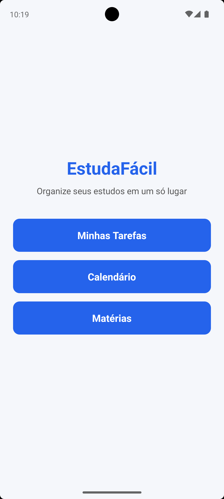
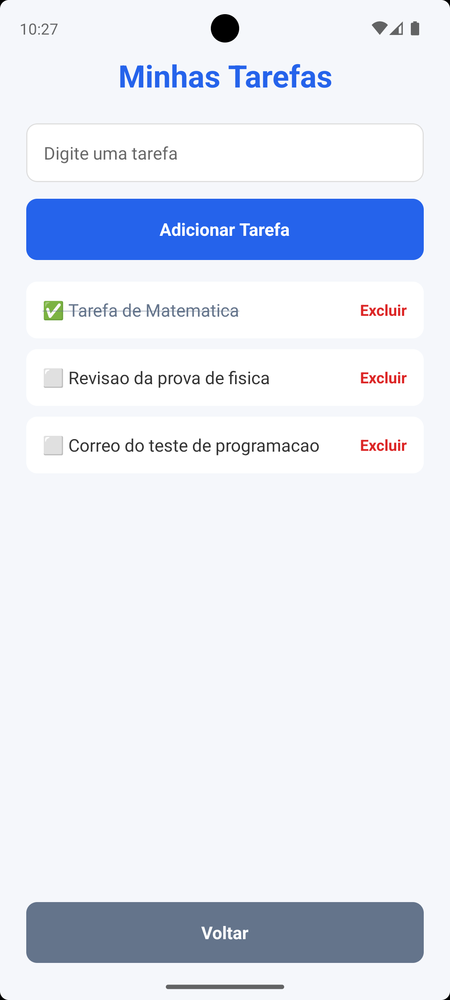
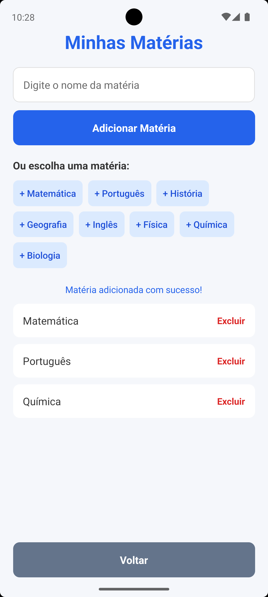

# 📚 EstudaFácil

### Organize seus estudos em um só lugar!

O **EstudaFácil** é um aplicativo de organização de estudos desenvolvido com **React Native, Expo e JavaScript**.

O projeto permite organizar tarefas, matérias escolares e atividades no calendário, mantendo as informações salvas localmente no dispositivo.

Além do desenvolvimento do aplicativo, o projeto contempla a preparação e a **simulação acadêmica de publicação na Google Play Store e na Apple App Store**.

---

## 📱 Telas do aplicativo

| Início | Tarefas | Matérias | Calendário |
|---|---|---|---|
|  |  |  |  |

As imagens acima representam as telas reais do aplicativo Android, capturadas durante os testes no emulador.

Também foram preparados quatro **mockups ilustrativos para iOS**, utilizados exclusivamente na simulação de publicação na Apple App Store. Essas imagens não são capturas de um aplicativo executado em iPhone.

---

## 🚀 Funcionalidades

### ✅ Minhas Tarefas

- Cadastrar tarefas de estudo.
- Marcar tarefas como concluídas.
- Excluir tarefas.

### 📘 Minhas Matérias

- Cadastrar matérias escolares.
- Selecionar matérias sugeridas.
- Impedir matérias duplicadas.
- Excluir matérias.

### 📅 Calendário

- Visualizar e navegar entre os meses.
- Selecionar datas.
- Cadastrar atividades em dias específicos.
- Identificar datas com atividades.
- Excluir atividades.

### 🔒 Privacidade

- Armazenamento local utilizando AsyncStorage.
- Utilização sem necessidade de cadastro ou login.
- Acesso à Política de Privacidade pela tela inicial.
- Revisão das permissões declaradas no aplicativo Android.

---

## 🛠️ Tecnologias utilizadas

- JavaScript
- React Native
- Expo SDK 58
- AsyncStorage
- Android Studio
- EAS Build
- Git e GitHub
- Bundletool

---

## ▶️ Como executar o projeto

### Pré-requisitos

- Node.js e npm instalados.
- Android Studio com emulador Android ou outro ambiente compatível com Expo.
- Dependências do projeto instaladas pelo npm.

### Instalação

Clone o repositório:

```bash
git clone https://github.com/rafaelborbaalveswolney/EstudaFacil.git
```

Entre na pasta do projeto:

```bash
cd EstudaFacil
```

Instale as dependências:

```bash
npm install
```

Inicie o projeto:

```bash
npx expo start
```

Depois, utilize um ambiente compatível com o Expo para abrir o aplicativo.

---

## 📦 Compilação Android

O projeto foi compilado utilizando o **Expo EAS Build**, com geração do Android App Bundle (AAB) para simulação de publicação na Google Play Store.

### Identificação do aplicativo

| Configuração | Valor |
|---|---|
| Nome | EstudaFácil |
| Versão | 1.0.0 |
| Código da versão Android | 3 |
| Identificador Android | `com.estudafacil.app` |
| Minimum SDK | 24 |
| Target SDK | 36 |
| Formato de produção | AAB |

### Arquivos gerados

**Binário principal de produção:**

`01_Binarios/EstudaFacil-release-v3.aab`

**Pacote de instalação utilizado nos testes da versão 3:**

`01_Binarios/EstudaFacil-v3.apks`

**APK de testes de uma versão anterior:**

`01_Binarios/EstudaFacil-preview-v2.apk`

O **AAB versão 3** foi gerado com credenciais de assinatura Android gerenciadas pelo EAS Build.

O arquivo `.apks` foi gerado a partir do AAB versão 3 utilizando o Bundletool, com assinatura de depuração para instalação no emulador.

**Importante:** o pacote `.apks` é um artefato auxiliar de testes. Para a simulação da entrega de produção na Google Play Store, o arquivo de referência é o **`EstudaFacil-release-v3.aab`**.

A versão 3 foi instalada e executada no emulador Android sem depender do Expo Go.

Os binários são mantidos localmente na pasta `01_Binarios` e não são armazenados diretamente no repositório Git.

### Assinatura digital

A integridade da assinatura do AAB versão 3 foi verificada com a ferramenta `jarsigner`.

O relatório detalhado está disponível em:

[Relatório de Assinatura Digital](05_Apresentacao/Relatorio_Assinatura_Digital.md)

A verificação da assinatura do AAB não representa aprovação ou publicação efetiva pela Google Play Store.

---

## 🧪 Testes realizados

Foram realizados testes funcionais do aplicativo no ambiente Android durante o desenvolvimento.

### Funcionalidades avaliadas

- Instalação e abertura do aplicativo.
- Navegação entre as telas.
- Cadastro, conclusão e exclusão de tarefas.
- Cadastro de matérias e prevenção de duplicatas.
- Navegação pelo calendário.
- Cadastro e exclusão de atividades.
- Persistência dos dados após fechar e reabrir o aplicativo.
- Acesso à Política de Privacidade.

### Validações realizadas na versão 3

Na versão Android com `versionCode=3`, foram confirmados:

- Geração do AAB de produção.
- Geração de pacote `.apks` a partir do AAB.
- Instalação limpa no emulador Android.
- Confirmação do `versionCode=3` e `versionName=1.0.0`.
- Execução do comando de inicialização do aplicativo.
- Persistência de uma matéria cadastrada após fechar e reabrir o aplicativo.

**Resultado:** as verificações realizadas na versão 3 apresentaram resultados satisfatórios nos cenários avaliados.

Os testes não representam uma certificação completa de qualidade ou segurança do aplicativo.

O relatório está disponível em:

[Relatório de Testes Finais](05_Apresentacao/Relatorio_Testes_Finais.md)

---

## 🛡️ Privacidade e permissões

O EstudaFácil utiliza armazenamento local para tarefas, matérias e atividades acadêmicas, sem exigir cadastro ou login.

Os dados cadastrados pelo usuário são gerenciados localmente por meio do AsyncStorage.

### Política de Privacidade

A Política de Privacidade foi preparada e disponibilizada publicamente em:

[Política de Privacidade do EstudaFácil](https://clever-palmier-327fdc.netlify.app/)

O projeto também contém versões locais da política nos formatos HTML e PDF.

### Permissões Android

Foi realizada uma revisão das permissões declaradas no aplicativo.

Na análise do manifesto do **AAB versão 3**, foram identificadas:

- `android.permission.INTERNET` — permissão de acesso à rede.
- `com.estudafacil.app.DYNAMIC_RECEIVER_NOT_EXPORTED_PERMISSION` — permissão interna relacionada à proteção de componentes do aplicativo.

As permissões de armazenamento externo identificadas em uma versão anterior não aparecem mais entre as permissões declaradas no módulo principal do AAB versão 3.

Também foram removidas as permissões anteriormente identificadas como desnecessárias:

- `SYSTEM_ALERT_WINDOW`
- `VIBRATE`
- `READ_EXTERNAL_STORAGE`
- `WRITE_EXTERNAL_STORAGE`

### Limitações da análise de privacidade

A análise realizada verificou as permissões declaradas e aspectos do código e das dependências utilizadas.

Entretanto, **não foi realizada uma auditoria completa do tráfego de rede ou do comportamento de todos os componentes de terceiros**.

Por esse motivo, a documentação não afirma categoricamente a ausência de qualquer comunicação externa ou coleta técnica de dados.

Essas limitações são consideradas nas simulações dos formulários de privacidade das lojas.

Documentos disponíveis:

- [Revisão de Privacidade e Permissões](04_Privacidade/Revisao_Privacidade_Permissoes.md)
- [Política de Privacidade](04_Privacidade/Politica_de_Privacidade.html)
- [Simulação dos Formulários de Privacidade](04_Privacidade/Simulacao_Formularios_Privacidade_EstudaFacil.pdf)

---

## 🏪 Simulação de publicação nas lojas

A atividade acadêmica contempla a preparação de materiais, documentos e procedimentos de publicação.

**Não foi realizada publicação real na Google Play Store ou na Apple App Store.**

### Google Play Store — Android

Foram preparados:

- Nome e descrições do aplicativo.
- Metadados de publicação.
- Ícone Android de 512 × 512 pixels.
- Imagem promocional de 1024 × 500 pixels.
- Quatro capturas reais do aplicativo Android.
- Política de Privacidade publicada.
- Simulação do formulário Segurança dos Dados.
- AAB de produção versão 3.
- Verificação de assinatura digital.
- Documentação de testes e permissões.

**Situação:** materiais preparados para simulação acadêmica. O aplicativo não foi enviado à Google Play Console.

[Simulação da Google Play Console](05_Apresentacao/Simulacao_Google_Play.md)

### Apple App Store — iOS

Foram preparados:

- Nome, descrição e subtítulo do aplicativo.
- Palavras-chave e metadados.
- Ícone iOS de 1024 × 1024 pixels.
- Quatro mockups ilustrativos das telas para iPhone.
- Política de Privacidade publicada.
- Simulação do formulário App Privacy.
- Identificador e configurações básicas iOS.

**Limitações:**

- Não foi gerado um arquivo IPA.
- O aplicativo não foi compilado ou testado em um dispositivo iOS.
- Os mockups não representam capturas reais de um build iOS.
- Não houve envio ou publicação na App Store Connect.

[Simulação da App Store Connect](05_Apresentacao/Simulacao_App_Store_iOS.md)

---

## 📂 Organização do projeto

```text
EstudaFacil/
├── 01_Binarios/
│   ├── EstudaFacil-release-v3.aab
│   ├── EstudaFacil-v3.apks
│   ├── EstudaFacil-preview-v2.apk
│   ├── AndroidManifest-release-v3.xml
│   └── bundletool-log.txt
│
├── 02_Imagens/
│   ├── android-icon.png
│   ├── feature-graphic.png
│   ├── icon.png
│   └── ios-icon.png
│
├── 03_Screenshots/
│   ├── Android/
│   │   ├── 01-inicio.png
│   │   ├── 02-tarefas.png
│   │   ├── 03-materias.png
│   │   └── 04-calendario.png
│   │
│   └── IOS/
│       ├── ios-01-inicio-mockup.png
│       ├── ios-02-tarefas-mockup.png
│       ├── ios-03-materias-mockup.png
│       └── ios-04-calendario-mockup.png
│
├── 04_Privacidade/
│   ├── Politica_de_Privacidade.html
│   ├── Politica_de_Privacidade_EstudaFacil.pdf
│   ├── Revisao_Privacidade_Permissoes.md
│   ├── Simulacao_Formularios_Privacidade_EstudaFacil.pdf
│   └── Site_Privacidade/
│       └── index.html
│
├── 05_Apresentacao/
│   ├── Apresentacao_EstudaFacil.pptx
│   ├── Metadados_EstudaFacil.md
│   ├── Relatorio_Assinatura_Digital.md
│   ├── Relatorio_Testes_Finais.md
│   ├── Roteiro_Apresentacao.md
│   ├── Simulacao_App_Store_iOS.md
│   └── Simulacao_Google_Play.md
│
├── assets/
├── scripts/
├── src/
│   ├── screens/
│   └── services/
├── App.js
├── app.json
├── eas.json
├── package.json
└── README.md
```

**Observação:** a estrutura acima destaca os arquivos principais da atividade. Pastas auxiliares do ambiente de desenvolvimento e arquivos de configuração adicionais podem estar presentes no projeto.

---

## 🎓 Objetivo acadêmico

Este projeto demonstra:

1. Desenvolvimento de um aplicativo móvel utilizando React Native e Expo.
2. Organização de informações com armazenamento local.
3. Preparação de identidade visual, imagens e metadados de publicação.
4. Geração e verificação de um Android App Bundle.
5. Instalação e execução do aplicativo Android em ambiente de testes.
6. Elaboração e publicação de uma Política de Privacidade.
7. Revisão de permissões e documentação das práticas de dados.
8. Simulação de publicação na Google Play Console e na App Store Connect.
9. Identificação das diferenças entre os processos de publicação Android e iOS.
10. Documentação e apresentação dos resultados obtidos.

---

## 👨‍💻 Autores

O aplicativo **EstudaFácil** foi desenvolvido por:

- Rafael Borba
- Davi Padilha
- Querley Junio

**Projeto acadêmico — Atividade 10**

Desenvolvido exclusivamente para fins educacionais.

---

**EstudaFácil — organize seus estudos em um só lugar!**